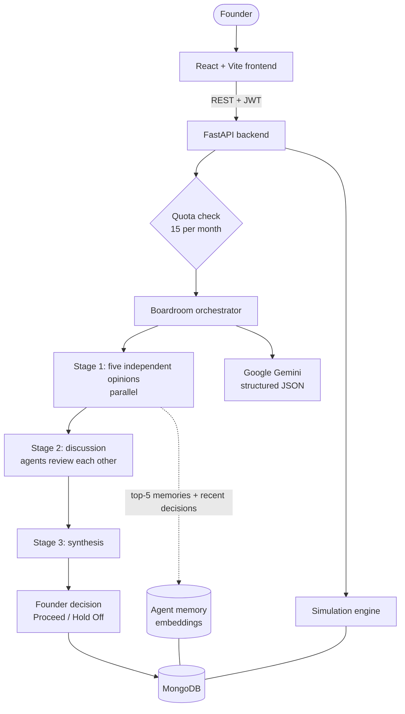

<div align="center">

# FounderVerse

### An AI startup simulator with a multi-agent boardroom

**Build. Decide. Evolve.**

[](https://founderverse-chi.vercel.app)


</div>

---

Early-stage founders make high-stakes decisions about spending, hiring, pricing and contracts with little data, no advisory team and no safe way to test the consequences. A single chatbot gives one blended answer, forgets what you decided last month and cannot show how a choice plays out over time.

**FounderVerse** fixes that by combining two ideas:

1. **An AI boardroom.** Five specialist agents (Finance, Marketing, Sales, CTO and Legal) each answer your question from their own executive role. They then read and challenge each other's views, and a final synthesis keeps the real disagreements instead of averaging them away.
2. **A month-by-month simulation.** Your company's customers, churn, revenue, expenses, profit, cash, runway and an indicative valuation are projected forward so you can watch decisions play out.

**The founder always decides.** Every consultation ends with a recorded *Proceed* or *Hold Off* decision and a written reason. That record is fed back to the agents in later consultations.

| | |
|---|---|
| **Live app** | https://founderverse-chi.vercel.app |
| **Backend API** | https://founderverse-backend.onrender.com (interactive docs at `/docs`) |

> The backend runs on a hosted instance, so the first request after a period of inactivity can be slow while the embedding model loads. If the first question takes a while, that is why.

<!-- Add screenshots once you have saved them in docs/images/ :
<p align="center">
  
  
</p>
-->

---

## Features

### Multi-agent boardroom
- **Five role-bound agents**, each with its own goals: Finance (cash, runway, costs), Marketing (acquisition, channels), Sales (pipeline, conversion), CTO (feasibility, scalability, security) and Legal (contracts, privacy, compliance).
- **Three-stage workflow:** independent opinions (run in parallel), then a discussion round where each agent reviews the other four, then a synthesis with agreements, unresolved disagreements, risks, next steps, success metrics and open assumptions.
- **Three consultation modes** to trade depth against API cost:

| Mode | What you get | LLM calls |
|---|---|---|
| Individual opinions | Five independent recommendations | 5 |
| Collaborative boardroom | Opinions, discussion and synthesis | 11 |
| Both experiences | Opinions first, then continue into discussion and synthesis on demand (no extra quota used) | 11 |

- **Single-LLM baseline** endpoint: one call over the same company context and memories, with timing and retrieval metrics, for fair comparison against the multi-agent design.

### Reliable, honest output
- Responses are generated as **schema-constrained JSON** and validated with Pydantic.
- A failed agent is **retried once**; if it still fails, the app shows an explicit "do not rely on this agent" notice instead of inventing advice.
- Model **fallback chain** and detection of truncated or empty LLM output.
- Agents are told not to invent company numbers, to flag missing information and not to change position just to agree with the majority.

### Persistent memory
- Every opinion is stored per agent and per company with a 384-dimension `all-MiniLM-L6-v2` embedding.
- Retrieval uses a weighted similarity: **0.7 x similarity to the stored question + 0.3 x similarity to the stored content**, a 0.25 minimum score and the top 5 results.
- Agents also receive the founder's five most recent decisions, including what was decided and why.

### Startup simulation
- Deterministic monthly engine with defaults calibrated on a SaaS billing dataset, and optional founder-supplied assumptions (new customers, churn, expense growth).
- Unknown revenue is kept as *unknown*, not silently treated as zero.
- A snapshot is stored for every month, giving a timeline and month-over-month changes.

### Platform
- Registration and login with **Argon2** password hashing and **JWT** authentication.
- **Per-company ownership checks** on every company-scoped endpoint.
- An **atomic monthly quota** of 15 consultations per user, safe under concurrent requests.
- Decision history with the full agent conversation for each decision.
- Light and dark themes, and an animated landing page.

---

## How it works



**Request flow**

1. The founder asks a question and picks a mode. The server checks company ownership, then atomically reserves one monthly question.
2. For each agent the orchestrator builds a context: company profile, the five most recent decisions and the five most relevant memories.
3. **Stage 1** runs all five agents concurrently and validates each answer.
4. **Stage 2** (collaborative modes) asks each agent to state agreements, disagreements, one overlooked insight and a revised position.
5. **Stage 3** synthesises everything without claiming consensus that does not exist.
6. The founder records a decision. An LLM classifier tags which agents were materially affected, and the record is stored for future context.

---

## Memory retrieval evaluation

Three retrieval strategies were compared on the same labelled memories, each returning five results:

| Metric | Stage 1: Recency only | Stage 2: Semantic 70/30 | Stage 3: Semantic + MMR (lambda 0.8) |
|---|---:|---:|---:|
| Judged Precision@5 | 37.00% | **69.50%** | **69.50%** |
| Conservative Precision@5 | 37.00% | 65.00% | 65.00% |
| Pooled Recall@5 | 60.70% | 83.36% | 83.36% |
| MRR | 0.725 | 0.950 | 0.950 |
| Normalized unique relevant coverage@5 | n/a | 58.33% | **68.33%** |
| Redundancy rate@5 (lower is better) | n/a | 60.00% | **50.00%** |
| Retrieval/scoring latency | 0.02 ms | 8.86 ms | 10.23 ms |

Within Stage 2, four weightings of question versus content similarity were also compared. The deployed **70/30** blend had the best judged precision (69.50%) and borderline-inclusive precision (80.50%), ahead of question-only (69.17%), 50/50 (66.33%) and content-only (67.33%).

**Takeaways:** semantic retrieval roughly doubles precision compared with simply using the most recent memories, and Maximal Marginal Relevance re-ranking keeps relevance unchanged while reducing repeated results. The deployed retriever uses the Stage 2 configuration; MMR was evaluated as an extension. The labelled set is small and relevance was judged by humans, so differences of about one percentage point should not be over-interpreted.

---

## Simulation model

Each month the engine applies:

```text
new customers   = round(customers x acquisition_rate)      # default 151.9 / 2800
churned         = min(customers, round(customers x churn)) # default 1.276% per month
customers'      = max(0, customers + new - churned)
revenue'        = customers' x (revenue / customers)       # revenue per customer held constant
expenses'       = expenses x (1 + growth)                  # default 1% per month
profit'         = revenue' - expenses'
cash'           = cash + profit'
runway          = cash' / (expenses' - revenue')           # if burning cash, otherwise 0
valuation       = revenue' x 12 x stage_multiplier         # idea 1, early 2, growth 4, scale 5
```

The defaults come from a SaaS dataset; the stage multipliers and expense growth are explicit modelling assumptions. **The valuation is an indicative proxy, not a formal valuation.**

---

## Tech stack

| Layer | Technology |
|---|---|
| Frontend | React 19, Vite 7, JavaScript, plain CSS |
| Backend | Python 3.11+, FastAPI, Uvicorn, Pydantic |
| Database | MongoDB (Atlas), PyMongo |
| LLM | Google Gemini via `google-genai`, schema-constrained JSON output |
| Memory | `sentence-transformers` (`all-MiniLM-L6-v2`), NumPy |
| Auth | JWT (PyJWT), Argon2 (pwdlib) |
| Hosting | Render (backend), Vercel (frontend) |

---

## Project structure

```text
FounderVerse/
├── backend/
│   ├── app/
│   │   ├── agents/          # BaseAgent + Finance, Marketing, Sales, CTO, Legal
│   │   ├── api/             # auth, companies, simulation, boardroom, decisions, experiments
│   │   ├── config/          # settings (environment variables)
│   │   ├── database/        # MongoDB connection, models, repositories
│   │   ├── llm/             # Gemini provider, structured output
│   │   ├── memory/          # memory manager and semantic retrieval
│   │   ├── orchestration/   # boardroom workflow, agent-impact classifier, single-LLM baseline
│   │   ├── simulation/      # monthly engine, dataset metrics, state
│   │   └── main.py
│   └── requirements.txt
├── frontend/
│   ├── src/
│   │   ├── pages/           # Login, CompanySetup
│   │   ├── services/        # API client
│   │   ├── App.jsx
│   │   ├── FounderVerseDashboard.jsx
│   │   ├── Landing.jsx
│   │   └── main.jsx
│   └── package.json
├── docs/
└── README.md
```

---

## API overview

All routes except `/health`, register and login need a `Authorization: Bearer <token>` header. Full interactive documentation is at `/docs` on the backend.

| Method | Path | Purpose |
|---|---|---|
| POST | `/api/auth/register` | Create an account and receive a JWT |
| POST | `/api/auth/login` | Log in and receive a JWT |
| GET | `/api/auth/me` | Current user |
| POST | `/api/companies/` | Create the company and its Month 1 snapshot |
| GET | `/api/companies/{id}` | Fetch your company |
| GET | `/api/simulation/{id}/state` | Current state, previous state and timeline |
| POST | `/api/simulation/{id}/advance` | Advance the simulation by one month |
| GET | `/api/boardroom/usage` | Monthly consultation usage |
| POST | `/api/boardroom/{id}/ask` | Start a consultation (individual, collaborative or both) |
| POST | `/api/boardroom/{id}/continue` | Run discussion and synthesis on existing opinions |
| POST | `/api/decisions/{id}` | Record Proceed / Hold Off with an explanation |
| GET | `/api/decisions/{id}` | Decision history |
| POST | `/api/experiments/{id}/single-llm` | Single-LLM research baseline with metrics |
| GET | `/health` | Health check |

---

## Getting started

### Prerequisites

- Python 3.11+
- Node.js 18+ and npm
- A MongoDB Atlas account (a free cluster is enough) or a local MongoDB
- A Google Gemini API key
- About **2 GB of free RAM** for the backend (see the note under Deployment)

### 1. Clone

```bash
git clone https://github.com/Anisha3056/FounderVerse_AIAgents.git
cd FounderVerse_AIAgents
```

### 2. Backend

```bash
cd backend
python -m venv .venv

# Windows PowerShell
.venv\Scripts\Activate.ps1
# Linux / macOS
source .venv/bin/activate

pip install -r requirements.txt
```

Create `backend/.env`:

```env
MONGODB_URI=<your_mongodb_connection_string>
MONGODB_DATABASE=founderverse
GEMINI_API_KEY=<your_gemini_api_key>
GEMINI_MODEL=<your_gemini_model_name>
JWT_SECRET_KEY=<a_long_random_secret>
JWT_ALGORITHM=HS256
ACCESS_TOKEN_EXPIRE_MINUTES=60
ENVIRONMENT=development
CORS_ORIGINS=http://localhost:5173
```

Start the API:

```bash
uvicorn app.main:app --reload
```

The API runs at `http://127.0.0.1:8000` and its docs at `http://127.0.0.1:8000/docs`.

### 3. Frontend

```bash
cd frontend
npm install
npm run dev
```

The app runs at `http://localhost:5173`. Point it at your backend with the API base URL environment variable described in `frontend/src/services/api.js` (use `http://127.0.0.1:8000` locally and your Render URL in production).

> The first consultation downloads the `all-MiniLM-L6-v2` model (about 90 MB), so it takes longer than later ones.

---

## Deployment

| Part | Platform | Notes |
|---|---|---|
| Frontend | **Vercel** | Build command `npm run build`, output directory `dist`. Set the API base URL environment variable to the Render backend URL. |
| Backend | **Render** web service | Start command `uvicorn app.main:app --host 0.0.0.0 --port $PORT`. Set the environment variables listed above, with `CORS_ORIGINS` set to the Vercel domain. |
| Database | **MongoDB Atlas** | Allow the Render service in the network access list. |

**Memory requirement.** The embedding model depends on PyTorch, which needs roughly 1 GB or more of RAM when loaded. A 512 MB instance fails with an out-of-memory error on the first consultation, while login, registration and the simulation still work. Use an instance with **2 GB RAM** and a single Uvicorn worker, because every extra worker loads its own copy of the model.

---

## Security

- Passwords are hashed with Argon2 and never stored or returned in plain form.
- JWTs are signed, expire after the configured time and return distinct errors for expired and invalid tokens.
- Login returns the same message for an unknown email and a wrong password.
- Every company-scoped endpoint verifies that the signed-in user owns the company, and it does so **before** a monthly question is reserved, so unauthorised requests cannot use up quota.
- Secrets are read from environment variables, never from source code.

---

## Limitations

- The agents are language models and can still be wrong or over-confident. Prompts and validation reduce but do not remove this.
- The simulation is deliberately simple: customer growth is proportional to the customer base, revenue per customer is constant and expense growth is a fixed rate. Founder decisions do not yet change the simulation parameters.
- Memory retrieval scans an agent's memories linearly, which is fine at this scale but will not suit very large histories.
- The retrieval evaluation uses a small, human-labelled set.
- Token and cost fields in the baseline experiment output are present but not yet populated.

## Roadmap

- [ ] Link recorded decisions to the simulation, so a *Proceed* decision changes later months.
- [ ] Stochastic simulation with confidence bands, fitted on more data.
- [ ] Enable MMR re-ranking in production after a wider evaluation (including a sweep of lambda values).
- [ ] Vector index for memory retrieval and summarisation of long histories.
- [ ] Lighter embedding runtime (ONNX) to run on smaller, cheaper instances, and model warm-up at start-up.
- [ ] Document upload and retrieval-augmented grounding (financial statements, contracts).
- [ ] Internal data-assistant agent for company knowledge retrieval.
- [ ] Automated tests, CI/CD and containerised deployment.

---

## Team

Built at **VIT-AP University**, School of Computer Science and Engineering, Amaravati, Andhra Pradesh, India.

- Tenali Anisha
- Kondaveeti Harshitha
- Yaradla Guru Akshitha
- Koti Bhavya Sri

## Disclaimer

FounderVerse is an experimental decision-support and simulation tool. Its recommendations and simulated outcomes are for exploration and learning, and are not professional business, financial or legal advice.

---

<div align="center">

**FounderVerse: Build. Decide. Evolve.**

</div>