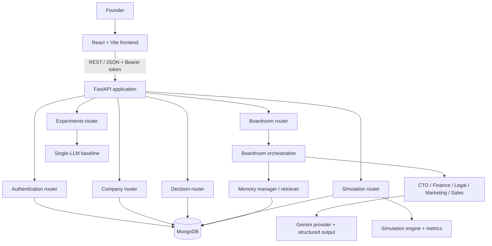

# FounderVerse — System Architecture

## 1. Purpose

FounderVerse is a web application for startup simulation and AI-assisted strategic decision support. The architecture separates the user interface, API layer, agent/LLM orchestration, simulation logic, persistence, and agent memory.

This document describes the implementation visible in the source snapshot shared on 6 November 2026. It is not a substitute for checking the current source tree.

## 2. High-level components

### Frontend

- React application built with Vite.
- Landing, login, company setup, and founder dashboard experiences.
- Calls the backend through a shared Fetch-based API service.
- Stores the authentication token in browser local storage in the supplied frontend snapshot.
- Sends Bearer authentication headers for protected operations.

### Backend API

- FastAPI application created in `backend/app/main.py`.
- Routers are registered for health, authentication, companies, simulation, boardroom, decisions, and experiments.
- Uses Pydantic models for request/state validation.
- Uses a lifespan handler to connect to MongoDB on startup and close the client on shutdown.
- CORS is configured for local frontend development in the supplied main-module snapshot. Production origins must be configured deliberately.

### Agent layer

Five role-specific agents are defined: CTO, Finance, Legal, Marketing, and Sales. Each agent has a specialized role and produces advice within its functional domain. See [agent-specifications.md](agent-specifications.md).

### Orchestration and LLM layer

- Boardroom orchestration coordinates specialist-agent responses and the discussion/continuation flow.
- A separate single-LLM baseline workflow exists under the experiments API.
- The LLM provider module integrates with Google Gemini.
- A structured-output module is present to validate/shape model responses.
- The exact call sequence and retry/fallback behavior should be verified in the current orchestration source before being represented as a production guarantee.

### Simulation layer

- `SimulationState` contains company ID, month, cash, revenue, expenses, profit, customers, churn rate, runway, and valuation.
- The simulation engine advances a company's business state and uses metrics/calibration assumptions.
- The engine's outputs are modelled simulation results, not guaranteed predictions of real-world startup performance.

### Persistence and memory

MongoDB stores application records. Agent memories are stored separately and include company and agent identifiers, memory type, content, metadata, embedding, and creation time. The supplied memory implementation uses `sentence-transformers/all-MiniLM-L6-v2` to generate normalized 384-dimensional embeddings.

## 3. Component interaction

## 4. Main request flows

### 4.1 Account and company setup

1. A user registers or logs in through the authentication API.
2. The backend validates credentials and issues a JWT access token.
3. The frontend includes the token in protected API requests.
4. The user submits company setup details.
5. The company API validates the payload and persists the company record.

### 4.2 Boardroom consultation

1. The frontend submits a question for a company.
2. The backend verifies the request and company context.
3. The boardroom orchestration coordinates role-specialized agent responses.
4. The LLM provider obtains model output and the structured-output layer shapes/validates it.
5. Relevant memory may be retrieved and/or saved for agent context.
6. The API returns the boardroom response to the frontend.
7. The founder can submit a selected decision through the decisions API.

The exact orchestration order, memory policy, and discussion turn limits should be maintained from the current source rather than inferred from this overview.

### 4.3 Simulation progression

1. The frontend requests the current simulation state.
2. The backend loads the persisted state for the company.
3. The founder requests a month advance.
4. The simulation engine computes the next state and metrics.
5. The repository persists the updated state.
6. The frontend refreshes the displayed company metrics.

## 5. Backend module map

| Module | Responsibility |
|---|---|
| `app/api/` | HTTP routes and request handling |
| `app/agents/` | Role-specialized agent definitions |
| `app/orchestration/` | Boardroom and baseline coordination |
| `app/llm/` | Gemini provider and structured output |
| `app/memory/` | Embedding generation, memory persistence, retrieval |
| `app/simulation/` | Simulation state, engine, and business metrics |
| `app/database/models/` | Pydantic data models |
| `app/database/repositories/` | MongoDB persistence operations |
| `app/config/` | Environment-backed settings |
| `app/main.py` | FastAPI application setup and router registration |

## 6. Cross-cutting concerns

- **Authentication:** JWT access tokens; password hashing through `pwdlib`.
- **Validation:** Pydantic request and state models.
- **Persistence:** MongoDB repositories.
- **LLM reliability:** structured output validation; model responses should still be treated as fallible.
- **Memory isolation:** memory is scoped by agent and company in the visible retrieval implementation.
- **CORS:** local development origins are visible in the supplied app setup; production configuration must be updated.
- **Observability:** add structured logs, request IDs, latency tracking, and error monitoring before production use.

## 7. Deployment topology

Recommended logical deployment:

- Frontend: static hosting for the Vite build.
- Backend: Python web service running Uvicorn.
- Database: managed MongoDB Atlas.
- LLM: Gemini API accessed only by the backend.

The exact hosting providers, build commands, health-check path, environment-variable configuration, and domain names must be recorded after the deployment is actually completed. See [deployment.md](deployment.md).
