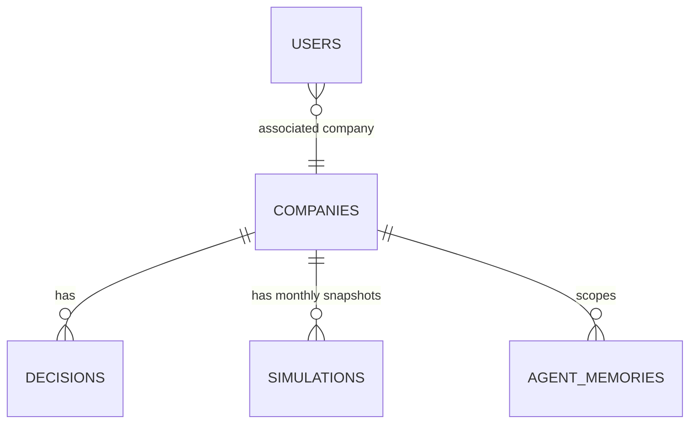

# FounderVerse — Database Schema

## 1. Database

The supplied backend uses MongoDB through PyMongo. The configured database name defaults to `founderverse` and can be overridden through `MONGODB_DATABASE`.

The collection descriptions below are based on the repositories and models visible in the source snapshot shared on 6 November 2026. Confirm indexes, optional fields, and actual production documents against the live database before applying migrations or publishing this as a formal schema contract.

## 2. Collections

### 2.1 `users`

Stores registered user accounts.

| Field | Description |
|---|---|
| `_id` | MongoDB document identifier |
| `email` | Normalized email address; repository lookup uses lowercase/trimmed email |
| `password_hash` | Hashed password; plaintext passwords must never be stored |
| `company_id` | Associated company identifier, where assigned |
| `plan` | Account plan; visible usage logic defaults to `free` |
| Usage metadata | Monthly consultation usage fields are maintained by repository logic |

The exact persisted field names should be confirmed in `user_repository.py` before external integrations depend on them.

### 2.2 `companies`

Stores company profiles and the current simulated company state.

| Field | Type / meaning |
|---|---|
| `_id` | MongoDB identifier |
| `company_name` | Required company name |
| `industry` | Industry; default in model is `SaaS` |
| `stage` | Startup stage; default in model is `idea` |
| `region` | Region or operating geography |
| `segment` | Customer segment |
| `target_market` | Target market description |
| `acquisition_channel` | Primary acquisition channel |
| `team_size` | Team size; minimum 1 |
| `initial_capital` | Initial capital |
| `initial_customers` | Initial customer count |
| `monthly_revenue` | Monthly revenue; may be null when unknown |
| `monthly_revenue_status` | `known` or `unknown` |
| `monthly_expenses` | Monthly expenses |
| `expected_new_customers` | Optional founder-provided monthly acquisition assumption |
| `known_monthly_churn_percent` | Optional churn assumption, 0–100 |
| `expected_monthly_expense_growth_percent` | Optional expense-growth assumption, 0–100 |
| `cash` | Current simulated cash |
| `revenue` | Current revenue value |
| `expenses` | Current expenses |
| `profit` | Current profit |
| `customers` | Current customer count |
| `churn_rate` | Current churn rate |
| `monthly_growth_rate` | Monthly growth rate |
| `runway_months` | Estimated runway |
| `valuation` | Simulated valuation |
| `current_month` | Current simulation month; model default is 1 |
| `metadata` | Additional metadata |
| `updated_at` | UTC update timestamp |

The `CompanyCreate` model rejects unknown extra fields and validates non-negative numeric inputs for the visible financial and customer assumptions.

### 2.3 `decisions`

Stores decisions submitted by the founder.

| Field | Description |
|---|---|
| `_id` | MongoDB identifier |
| `company_id` | Associated company |
| `question` | Original strategic question |
| `decision` | Selected decision/action |
| `explanation` | Founder-provided explanation |
| `affected_agents` | Agent names associated with the decision |
| `boardroom_responses` | Related boardroom response payloads |
| `simulation_month` | Month at which the decision was recorded; model default is 1 |
| `created_at` | UTC creation timestamp |

### 2.4 `simulations`

Stores monthly simulation snapshots.

The visible simulation repository persists a state containing:

| Field | Description |
|---|---|
| `company_id` | Associated company |
| `month` | Simulation month |
| `cash` | Cash |
| `revenue` | Revenue |
| `expenses` | Expenses |
| `profit` | Profit |
| `customers` | Customer count |
| `churn_rate` | Churn rate |
| `runway_months` | Runway |
| `valuation` | Valuation |

The repository retrieves snapshots by company and orders them by month. Confirm the exact upsert/insert behavior and any additional fields in the current repository implementation.

### 2.5 `agent_memories`

Stores company-scoped memories used by specialist agents.

| Field | Description |
|---|---|
| `_id` | MongoDB identifier |
| `agent_name` | Agent associated with the memory |
| `company_id` | Company scope |
| `memory_type` | Memory category |
| `content` | Memory text |
| `metadata` | Additional context |
| `embedding` | Normalized 384-dimensional vector |
| `created_at` | UTC creation timestamp |

The supplied implementation uses `sentence-transformers/all-MiniLM-L6-v2` for embeddings. The visible retrieval logic filters by agent and company and ranks memories using question/content similarity.

## 3. Relationships

These are logical relationships expressed through stored identifiers; MongoDB does not enforce them as relational foreign keys.

## 4. Data integrity recommendations

Before production:
- Create and verify a unique index on normalized user email.
- Index `company_id` on decisions and simulations.
- Index `{company_id, agent_name, created_at}` or the query patterns actually used for agent memories.
- Validate that every company-scoped request checks the authenticated user's authorization for that company.
- Use UTC timestamps consistently.
- Define retention/deletion behavior for user accounts, company data, decisions, and agent memories.
- Back up the database and test restoration.
- Avoid storing secrets or unnecessary personal data in company metadata or agent memories.

## 5. Schema evolution

For every schema change:
1. Update the Pydantic model.
2. Update the repository serialization/deserialization logic.
3. Update API request/response documentation.
4. Add migration or backfill logic if existing documents require it.
5. Add tests for old and new document shapes.
6. Update this document.
